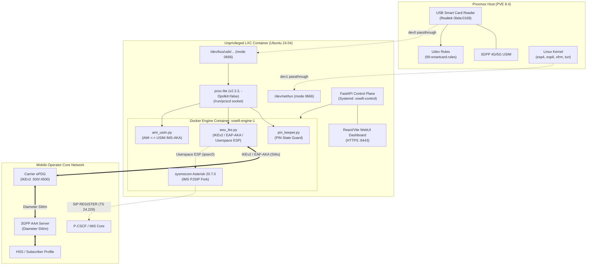

# VoWiFi Software UE & Gateway (LXC / Docker)

A containerized, open-source **Voice over WiFi (VoWiFi / Wi-Fi Calling) Software User Equipment (UE)** implementation designed for Linux servers and Proxmox VE LXC environments using physical USB Smart Card Readers (CCID) and cellular USIM cards.

---

## Highlights

* **Hardware USIM Integration:** Direct PC/SC interface (`pyscard` / `pcscd`) with physical 3GPP USIM / UICC smart cards.
* **3GPP SWu Interface:** Pure-Python IKEv2 / IPsec client (`swu_ike.py`) executing RFC 4187 **EAP-AKA** authentication via the SIM's onboard Milenage algorithm.
* **IMS Core (SIP/VoIP):** Powered by **sysmocom Asterisk 20.7.0** with IMS PJSIP, IMS-AKA digest, cellular SMS-over-IP (`SIP MESSAGE`), and P-Access-Network-Info (PANI) header injection.
* **WebRTC & Softphone:** WebUI dashboard with an integrated browser softphone, real-time line telemetry, and SMS inbox/outbox. Supports reverse proxy and custom domain integration.
* **eSIM / eUICC Management:** Integrated GSMA SGP.22 Local Profile Assistant (`lpac`) for over-the-air profile download, enabling, disabling, and switching on physical eUICC / ESTKme cards directly from the WebUI.
* **Proxmox VE 8+ Native:** Designed to run inside unprivileged Proxmox LXC containers with native character device and TUN passthrough.
* **Turnkey LXC Templates:** Includes pre-packaged Proxmox appliance archives (`local:vztmpl`) and instant linked-clone master templates for rapid multi-SIM scale-out.

---

## Architecture



---

## Directory Structure

* **[`docs/`](docs/)**: In-depth architectural, protocol, and configuration documents.
  * [`docs/ARCHITECTURE.md`](docs/ARCHITECTURE.md) — Detailed technical architecture breakdown.
  * [`docs/MULTI_SIM_SETUP.md`](docs/MULTI_SIM_SETUP.md) — Multi-SIM & multi-line concurrency guide.
  * [`docs/CAPACITY_PLANNING_100_SIMS.md`](docs/CAPACITY_PLANNING_100_SIMS.md) — Capacity planning, resource sizing & hardware architecture for 100 concurrent SIMs.
  * [`docs/PROXMOX_LXC_PASSTHROUGH.md`](docs/PROXMOX_LXC_PASSTHROUGH.md) — Proxmox host udev & unprivileged LXC device configuration.
  * [`docs/VOWIFI_REGISTRATION_TRACE.md`](docs/VOWIFI_REGISTRATION_TRACE.md) — Annotated cryptographic trace of IKE_SA_INIT, EAP-AKA, and HSS responses.
  * [`docs/OPERATOR_CONFIG_EXAMPLE.md`](docs/OPERATOR_CONFIG_EXAMPLE.md) — General operator profile, DNS resolution, and protocol tuning guide.
  * [`docs/SMS_DELIVERY_FALSE_FAILURE.md`](docs/SMS_DELIVERY_FALSE_FAILURE.md) — Diagnosis and resolution of false-positive SIP 405 SMS delivery failures.
  * [`docs/INBOUND_CALL_ONE_WAY_AUDIO.md`](docs/INBOUND_CALL_ONE_WAY_AUDIO.md) — Inbound call one-way audio, SDP fmtp answer alignment, and 10-second dropped call resolution.
  * [`docs/REVERSE_PROXY_WEBRTC_SETUP.md`](docs/REVERSE_PROXY_WEBRTC_SETUP.md) — Reverse proxy, domain & Cloudflare WebRTC softphone integration guide.
  * [`docs/ESIM_SETUP_AND_MANAGEMENT.md`](docs/ESIM_SETUP_AND_MANAGEMENT.md) — eSIM / eUICC profile download, switching, and lpac toolchain guide.
  * [`docs/SOURCES_AND_ATTRIBUTION.md`](docs/SOURCES_AND_ATTRIBUTION.md) — Comprehensive attribution of upstream open-source projects and standards.
* **[`configs/`](configs/)**: Production configuration examples and templates.
  * [`configs/proxmox/105.conf.example`](configs/proxmox/105.conf.example) — Sample active Proxmox container configuration.
  * [`configs/proxmox/template_107.conf.example`](configs/proxmox/template_107.conf.example) — Clean master Proxmox LXC template configuration.
  * [`configs/proxmox/99-smartcard.rules`](configs/proxmox/99-smartcard.rules) — Host udev rule for persistent CCID permissions.
  * [`configs/vowifi/config.yaml.example`](configs/vowifi/config.yaml.example) — Control plane configuration.
  * [`configs/vowifi/instance.json.example`](configs/vowifi/instance.json.example) — Rendered per-SIM instance specification.
* **[`patches/`](patches/)**: Upstream C patches.
  * [`patches/asterisk/01_rp_ack_submit_report.patch`](patches/asterisk/01_rp_ack_submit_report.patch) — Enables 3GPP TS 24.011 2-byte RP-ACK submit report handling in Asterisk PJSIP messaging.
  * [`patches/asterisk/02_inbound_sip_dedup_and_dtmf_subset.patch`](patches/asterisk/02_inbound_sip_dedup_and_dtmf_subset.patch) — Deduplicates P-Access-Network-Info headers in session responses and aligns telephone-event DTMF fmtp with RFC 4733 answer subsets.
* **[`scripts/`](scripts/)**: Helper automation and diagnostic tools.
  * [`scripts/setup_lxc_host.sh`](scripts/setup_lxc_host.sh) — Automates host-level module loading and udev setup.
  * [`scripts/deploy_lxc.sh`](scripts/deploy_lxc.sh) — Turnkey automated deployment inside the LXC container.
  * [`scripts/build_engine_fast.sh`](scripts/build_engine_fast.sh) — Builds the `vowifi/engine` container image in seconds.
  * [`scripts/patch_swu_ike.py`](scripts/patch_swu_ike.py) — Compatibility patcher for Python 3.14 multiprocessing & IPv6 link-local derivation.
  * [`scripts/patch_sms_delivery.py`](scripts/patch_sms_delivery.py) — Applies dialplan and control-plane fixes for accurate SMS delivery reporting.
  * [`scripts/patch_inbound_audio.py`](scripts/patch_inbound_audio.py) — Fixes inbound call 10-second drops, RFC 3262 100rel/PRACK negotiation, session timers, and RTP keepalive pinholing.
  * [`scripts/patch_webrtc_proxy.py`](scripts/patch_webrtc_proxy.py) — Adds integrated WebSocket reverse proxy for WebRTC softphones over port 443.
  * [`scripts/install_esim_lpac.sh`](scripts/install_esim_lpac.sh) — Turnkey compiler and installer for the `lpac` eSIM Local Profile Assistant toolchain.
  * [`scripts/check_sim.py`](scripts/check_sim.py) — Standalone diagnostic script to inspect the SIM and test ePDG DNS.
* **[`Dockerfile.fast`](Dockerfile.fast)**: Layered Dockerfile optimizing build time for the Asterisk VoWiFi engine.

---

## Prerequisites & Checklist

Before deploying, ensure you have:
1. **USB Smart Card Reader:** A CCID-compliant USB reader (e.g. Realtek, Omnikey, ACS) plugged into the host.
2. **Physical USIM Card:** A 3GPP LTE/5G SIM card with **VoWiFi / VoLTE service activated** by the carrier (the `ims` APN must be provisioned in the HSS).
3. **ePDG DNS Reachability:** Carrier ePDG hostname (`epdg.epc.mnc<MNC>.mcc<MCC>.pub.3gppnetwork.org`) must resolve from your network (run `scripts/check_sim.py` to verify).
4. **Proxmox VE 8+ / Linux:** With kernel IPsec modules enabled.

---

## Deployment Options

### Method A: Turnkey Proxmox LXC Template (Recommended)

A pre-built, sanitized master LXC template is stored in Proxmox with all dependencies, Asterisk IMS patches, Docker images, and auto-detecting control plane pre-installed.

#### Option 1: Proxmox Web GUI
1. In the Proxmox tree, right-click **`vowifi-template`** (VMID 107) $\rightarrow$ **Clone**.
2. **Mode:**
   - **Linked Clone** *(Instant, 0 extra disk space)*
   - **Full Clone** *(Independent copy)*
3. Enter your new VMID and Name (e.g. `vowifi-sim2`).
4. Go to **Network** $\rightarrow$ assign your static IP (or leave as DHCP).
5. Start container!

*Alternatively*, click **Create CT** at the top right $\rightarrow$ under **Template**, select `local:vztmpl/vowifi-gateway-clean-ubuntu-24.04.tar.zst`.

#### Option 2: Proxmox CLI
```bash
# 1. Clone template (e.g. into VMID 108)
pct clone 107 108 --hostname vowifi-sim2

# 2. Assign static IP
pct set 108 -net0 name=eth0,bridge=vmbr0,firewall=1,gw=192.168.1.1,ip=192.168.1.108/24

# 3. Pass through the dedicated USB SIM reader (adjust bus/device from lsusb)
pct set 108 -dev0 /dev/bus/usb/001/005,mode=0666

# 4. Start the container
pct start 108
```

---

### Method B: Clean Installation from Scratch

#### 1. Host Preparation (Proxmox Host)
Run the automated host setup script to configure udev rules and kernel modules:
```bash
git clone https://github.com/mosfaqur/vowifi.git /root/vowifi
/root/vowifi/scripts/setup_lxc_host.sh
```

#### 2. Proxmox Container Configuration
In `/etc/pve/lxc/<VMID>.conf`, ensure the following passthrough devices and features are enabled:
```ini
features: nesting=1,keyctl=1
dev0: /dev/bus/usb/001/002,mode=0666
dev1: /dev/net/tun,mode=0666
```
*(Adjust the USB bus and device numbers to match `lsusb` on your host).*

#### 3. Deploy Inside the LXC Container
Log in to your Ubuntu 24.04 container and run the automated deployment script:
```bash
git clone https://github.com/mosfaqur/vowifi.git /root/vowifi
/root/vowifi/scripts/deploy_lxc.sh
```
> **Tip:** `deploy_lxc.sh` automatically fetches the gateway codebase, builds the fast Asterisk engine layer in ~30 seconds (bypassing the standard 20-minute compile), and configures the control plane service.

---

## Configuration & Access

### 1. Essential Carrier Configuration Note
When provisioning your SIM line in the WebUI:
* **APN:** Set to `ims`.
* **IDr Mode:** If your operator's ePDG rejects registration with `AUTHENTICATION_FAILED (24)`, ensure `idr_mode` is set to **`apn`** (bare string `"ims"`) rather than `fqdn`. See [`docs/OPERATOR_CONFIG_EXAMPLE.md`](docs/OPERATOR_CONFIG_EXAMPLE.md).

### 2. Access the WebUI
Open your browser and navigate to:
```text
https://<LXC_IP>:8443
```
Accept the self-signed TLS certificate to access the line dashboard, softphone, and SMS messages.

### 3. Verify Registration via CLI
Check that your line successfully registered to the carrier IMS core:
```bash
docker exec vowifi-engine-1 asterisk -rx 'pjsip show registrations'
```
Expected output:
```text
 <Registration/ServerURI..............................>  <Auth....................>  <Status.......>
==========================================================================================
 volte_ims/sip:ims.mnc003.mcc470.3gppnetwork.org         volte_ims                   Registered
```

---

## Attribution & Licenses

This project integrates work from several specialized open-source cellular projects:
* [pagecat/vowifi_gateway](https://github.com/pagecat/vowifi_gateway) (VoCat - MIT License)
* [fasferraz/SWu-IKEv2](https://github.com/fasferraz/SWu-IKEv2) (Fernando Ferraz)
* [sysmocom/asterisk & pjproject](https://gitea.sysmocom.de/sysmocom/asterisk) (sysmocom - s.f.m.c. GmbH)
* [mitshell/CryptoMobile & card](https://github.com/mitshell/CryptoMobile) (Benoit Michau)
* [LudovicRousseau/PCSC & CCID](https://github.com/LudovicRousseau/PCSC) (Ludovic Rousseau)

See [`docs/SOURCES_AND_ATTRIBUTION.md`](docs/SOURCES_AND_ATTRIBUTION.md) for complete details.
