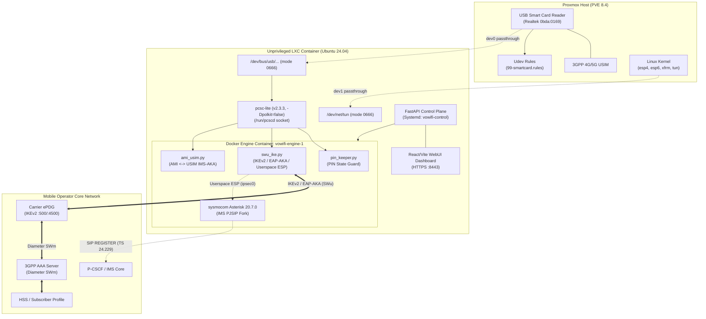

# VoWiFi Software UE & Gateway (LXC / Docker)

A containerized, open-source **Voice over WiFi (VoWiFi / Wi-Fi Calling) Software User Equipment (UE)** implementation designed for Linux servers and Proxmox VE LXC environments using physical USB Smart Card Readers (CCID) and cellular USIM cards.

---

## Highlights

* **Hardware USIM Integration:** Direct PC/SC interface (`pyscard` / `pcscd`) with physical 3GPP USIM / UICC smart cards.
* **3GPP SWu Interface:** Pure-Python IKEv2 / IPsec client (`swu_ike.py`) executing RFC 4187 **EAP-AKA** authentication via the SIM's onboard Milenage algorithm.
* **IMS Core (SIP/VoIP):** Powered by **sysmocom Asterisk 20.7.0** with IMS PJSIP, IMS-AKA digest, cellular SMS-over-IP (`SIP MESSAGE`), and P-Access-Network-Info (PANI) header injection.
* **WebRTC & Softphone:** WebUI dashboard with an integrated browser softphone, real-time line telemetry, and SMS inbox/outbox.
* **Proxmox VE 8+ Native:** Designed to run inside unprivileged Proxmox LXC containers with native character device and TUN passthrough.

---

## Architecture



---

## Directory Structure

* **[`docs/`](docs/)**: In-depth architectural, protocol, and configuration documents.
  * [`docs/ARCHITECTURE.md`](docs/ARCHITECTURE.md) — Detailed technical architecture breakdown.
  * [`docs/PROXMOX_LXC_PASSTHROUGH.md`](docs/PROXMOX_LXC_PASSTHROUGH.md) — Proxmox host udev & unprivileged LXC device configuration.
  * [`docs/VOWIFI_REGISTRATION_TRACE.md`](docs/VOWIFI_REGISTRATION_TRACE.md) — Annotated cryptographic trace of IKE_SA_INIT, EAP-AKA, and HSS responses.
  * [`docs/OPERATOR_CONFIG_EXAMPLE.md`](docs/OPERATOR_CONFIG_EXAMPLE.md) — General operator profile, DNS resolution, and protocol tuning guide.
  * [`docs/SOURCES_AND_ATTRIBUTION.md`](docs/SOURCES_AND_ATTRIBUTION.md) — Comprehensive attribution of upstream open-source projects and standards.
* **[`configs/`](configs/)**: Production configuration examples and templates.
  * [`configs/proxmox/105.conf.example`](configs/proxmox/105.conf.example) — Sample Proxmox container configuration.
  * [`configs/proxmox/99-smartcard.rules`](configs/proxmox/99-smartcard.rules) — Host udev rule for persistent CCID permissions.
  * [`configs/vowifi/config.yaml.example`](configs/vowifi/config.yaml.example) — Control plane configuration.
  * [`configs/vowifi/instance.json.example`](configs/vowifi/instance.json.example) — Rendered per-SIM instance specification.
* **[`scripts/`](scripts/)**: Helper automation and diagnostic tools.
  * [`scripts/setup_lxc_host.sh`](scripts/setup_lxc_host.sh) — Automates host-level module loading and udev setup.
  * [`scripts/deploy_lxc.sh`](scripts/deploy_lxc.sh) — Turnkey automated deployment inside the LXC container.
  * [`scripts/build_engine_fast.sh`](scripts/build_engine_fast.sh) — Builds the `vowifi/engine` container image in seconds.
  * [`scripts/check_sim.py`](scripts/check_sim.py) — Standalone diagnostic script to inspect the SIM and test ePDG DNS.
* **[`Dockerfile.fast`](Dockerfile.fast)**: Layered Dockerfile optimizing build time for the Asterisk VoWiFi engine.

---

## Prerequisites & Checklist

Before deploying, ensure you have:
1. **USB Smart Card Reader:** A CCID-compliant USB reader (e.g. Realtek, Omnikey, ACS) plugged into the host.
2. **Physical USIM Card:** A 3GPP LTE/5G SIM card with **VoWiFi / VoLTE service activated** by the carrier (the `ims` APN must be provisioned in the HSS).
3. **ePDG DNS Reachability:** Carrier ePDG hostname (`epdg.epc.mnc<MNC>.mcc<MCC>.pub.3gppnetwork.org`) must resolve from your network (run `scripts/check_sim.py` to verify).
4. **Proxmox VE 8+ / Linux:** With kernel IPsec modules enabled.

---

## Quick Start

### 1. Host Preparation (Proxmox Host)
Run the automated host setup script or manually install the udev rule and load IPsec kernel modules:
```bash
# Clone the repository on the Proxmox host
git clone https://github.com/mosfaqur/vowifi.git /root/vowifi
/root/vowifi/scripts/setup_lxc_host.sh
```

### 2. Proxmox Container Configuration
In `/etc/pve/lxc/<VMID>.conf`, ensure the following passthrough devices and features are enabled:
```ini
features: nesting=1,keyctl=1
dev0: /dev/bus/usb/001/002,mode=0666
dev1: /dev/net/tun,mode=0666
```
*(Adjust the USB bus and device numbers to match `lsusb` on your host).*

### 3. Deploy Inside the LXC Container
Log in to your Ubuntu 24.04 container and run the automated deployment script:
```bash
git clone https://github.com/mosfaqur/vowifi.git /root/vowifi
/root/vowifi/scripts/deploy_lxc.sh
```
> **Tip:** `deploy_lxc.sh` automatically fetches the upstream gateway codebase, builds the fast Asterisk engine layer in ~30 seconds (bypassing the standard 20-minute compile), and configures the control plane service.

### 4. Essential Carrier Configuration Note
When provisioning your SIM line in the WebUI:
* **APN:** Set to `ims`.
* **IDr Mode:** If your operator's ePDG rejects registration with `AUTHENTICATION_FAILED (24)`, ensure `idr_mode` is set to **`apn`** (bare string `"ims"`) rather than `fqdn`. See [`docs/OPERATOR_CONFIG_EXAMPLE.md`](docs/OPERATOR_CONFIG_EXAMPLE.md).

### 5. Access the WebUI
Open your browser and navigate to:
```text
https://<LXC_IP>:8443
```
Accept the self-signed TLS certificate to access the line dashboard, softphone, and SMS messages.

---

## Attribution & Licenses

This project integrates work from several specialized open-source cellular projects:
* [pagecat/vowifi_gateway](https://github.com/pagecat/vowifi_gateway) (VoCat - MIT License)
* [fasferraz/SWu-IKEv2](https://github.com/fasferraz/SWu-IKEv2) (Fernando Ferraz)
* [sysmocom/asterisk & pjproject](https://gitea.sysmocom.de/sysmocom/asterisk) (sysmocom - s.f.m.c. GmbH)
* [mitshell/CryptoMobile & card](https://github.com/mitshell/CryptoMobile) (Benoit Michau)
* [LudovicRousseau/PCSC & CCID](https://github.com/LudovicRousseau/PCSC) (Ludovic Rousseau)

See [`docs/SOURCES_AND_ATTRIBUTION.md`](docs/SOURCES_AND_ATTRIBUTION.md) for complete details.
