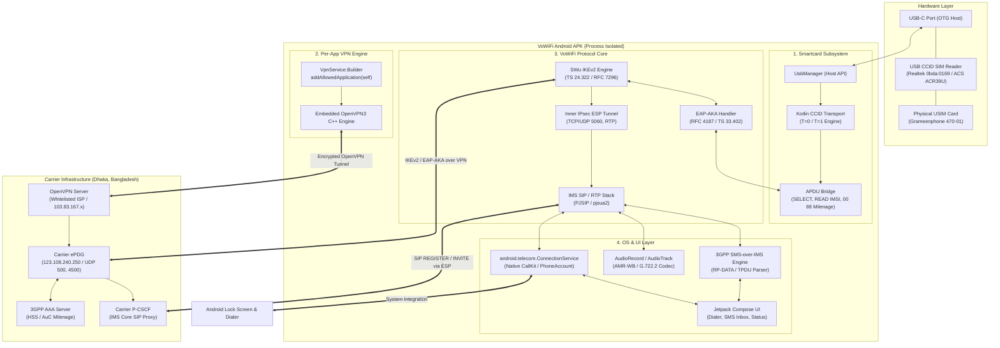
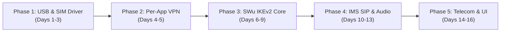

# Architecture Blueprint: Standalone Android VoWiFi Client with External USB-C SIM & Per-App VPN

## Executive Summary

This document specifies the technical architecture, protocol stacks, subsystem interactions, and step-by-step implementation plan for a dedicated Android application (**VoWiFi Direct**).

The application allows an Android device (without root privileges) to:
1. Interface with an external physical SIM card plugged into the phone's USB-C port via a USB CCID card reader.
2. Establish a **Per-App OpenVPN tunnel** (routing *only* this application's packets through the VPN to Bangladesh, leaving all other phone apps, browsers, and system traffic completely untouched on local network).
3. Execute the 3GPP SWu IKEv2 / IPsec session and EAP-AKA mutual authentication using the physical USB SIM.
4. Register with the carrier IMS core (P-CSCF) and provide native Android calling (lock-screen UI, Bluetooth, Android Auto) via `ConnectionService` alongside an SMS inbox.

---

## 1. High-Level System Architecture



---

## 2. Subsystem Specifications

### 2.1 Per-App OpenVPN Isolation (Zero Impact on Phone's Other Apps)

> [!IMPORTANT]
> The OpenVPN tunnel must strictly capture traffic generated by this application's UID. The phone's banking apps, browser, WhatsApp, and background sync must continue using normal Wi-Fi / 5G directly with zero IP changes or latency impact.

#### Implementation Details:
Using Android's official `VpnService.Builder`:
```kotlin
val builder = VpnService.Builder().apply {
    setSession("VoWiFi Dedicated Tunnel")
    setMtu(1360) // Clamped to prevent outer carrier packet fragmentation
    addAddress("10.8.0.5", 24)
    addRoute("0.0.0.0", 0) // Capture default route ONLY for permitted apps
    
    // CRITICAL: Restrict VPN scope exclusively to this app package
    addAllowedApplication(context.packageName)
    
    // Explicitly disallow any other application on the device
    // All other apps bypass this tun interface entirely at the Linux kernel level
}
val vpnInterface: ParcelFileDescriptor = builder.establish()!!
```

- **Kernel Policy Routing:** Android creates an isolated routing table with `ip rule add uidrange <app_uid>-<app_uid> lookup <vpn_table>`.
- **Outer Socket Protection:** The embedded OpenVPN UDP socket calls `vpnService.protect(socket.fileDescriptor$fd)` so its encrypted transport packets travel out the physical network without recursion.

---

### 2.2 USB-C CCID Smartcard Driver (No Root Required)

Commercial carrier SIM cards lock their internal slots behind Carrier Privileges (`ARA-M`). When connected via USB-C OTG, the smartcard reader is managed through Android's `UsbManager` (standard USB Host API):

1. **Device Enumeration:**
   - Filters for USB interfaces matching `bInterfaceClass == 0x0B` (CCID Specification) or known Vendor/Product IDs (`0bda:0169` Realtek, `072f:90cc` ACS).
   - Prompts user once via `UsbManager.requestPermission()` with `FLAG_IMMUTABLE`.
2. **CCID Protocol Engine (Pure Kotlin):**
   - Transmits `PC_to_RDR_IccPowerOn` (`0x62`) to warm-reset the card and receive the ATR.
   - Wraps APDUs into `PC_to_RDR_XfrBlock` (`0x6F`) bulk-out transfers and unmarshals `RDR_to_PC_DataBlock` (`0x80`) bulk-in transfers.
3. **Milenage EAP-AKA Execution Routine:**
   ```kotlin
   suspend fun authenticateAka(rand: ByteArray, autn: ByteArray): AkaAuthResult {
       // APDU: CLA=00, INS=88, P1=00, P2=81 (USIM 3G Context), Lc=22 (34 bytes)
       val apdu = byteArrayOf(0x00.toByte(), 0x88.toByte(), 0x00.toByte(), 0x81.toByte(), 0x22.toByte()) +
                  byteArrayOf(0x10.toByte()) + rand +
                  byteArrayOf(0x10.toByte()) + autn
       
       val response = ccidTransport.sendApdu(apdu)
       val sw1 = response[response.size - 2].toInt() and 0xFF
       val sw2 = response[response.size - 1].toInt() and 0xFF
       
       if (sw1 == 0x90 && sw2 == 0x00) {
           // Parse DB tag: RES, CK, IK
           return parseAkaSuccess(response)
       } else if (sw1 == 0x98 && sw2 == 0x62) {
           throw AkaException("MAC Failure: Invalid network AUTN token")
       } else if (sw1 == 0x98 && sw2 == 0x64) {
           // Synchronization failure: return AUTS
           return parseAkaSyncFailure(response)
       }
       throw AkaException("SIM reject SW=$sw1$sw2")
   }
   ```

---

### 2.3 SWu IKEv2 & IPsec Protocol Stack

The IKEv2 stack follows 3GPP TS 24.322 specifications:
1. **`IKE_SA_INIT`:**
   - Initiates to carrier ePDG (`123.108.240.250:500`) through the OpenVPN tunnel.
   - Offers proposals: `ENCR_AES_CBC` (128/256), `PRF_HMAC_SHA2_256`, `AUTH_HMAC_SHA2_256_128`, `MODP_2048` (DH Group 14).
2. **`IKE_AUTH` Phase 1 (Identity):**
   - Presents IDi formatted as 3GPP Root NAI:
     `0<IMSI>@nai.epc.mnc001.mcc470.3gppnetwork.org`
   - Requests APN in IDr (`ims`).
3. **`IKE_AUTH` Phase 2 (EAP-AKA):**
   - Receives EAP-AKA Challenge (`RAND` + `AUTN`).
   - Dispatches APDU to physical SIM via USB CCID driver.
   - Returns EAP-AKA Response (`RES`).
4. **`IKE_AUTH` Phase 3 (SA Establishment & CFG):**
   - Receives `EAP-Success`.
   - Sends cryptographic proof (`AUTH` payload) derived from `K_aut`.
   - Obtains:
     - Assigned UE IPv6 address (e.g. `2403:9800:xx::/64`).
     - Carrier P-CSCF IPv6 address (e.g. `2403:9800:30:31:ffff:ffff:ffff:fff6`).
     - ESP encryption and authentication keys.

---

### 2.4 Native Telecom Subsystem (`ConnectionService`)

To deliver an authentic smartphone experience rather than a clunky VoIP app UI:

```kotlin
class VoWifiConnectionService : ConnectionService() {
    override fun onCreateIncomingConnection(
        connectionManagerPhoneAccount: PhoneAccountHandle?,
        request: ConnectionRequest?
    ): Connection {
        val conn = VoWifiCallConnection(sipEngine)
        conn.setCallerDisplayName(request?.extras?.getString("CALLER_NAME"), TelecomManager.PRESENTATION_ALLOWED)
        conn.setAddress(Uri.fromParts("tel", request?.extras?.getString("CALLER_NUMBER"), null), TelecomManager.PRESENTATION_ALLOWED)
        conn.connectionCapabilities = Connection.CAPABILITY_SUPPORT_HOLD or Connection.CAPABILITY_MUTE
        conn.setAudioModeIsVoip(true)
        return conn
    }
}
```

- **Lock Screen Integration:** Rings using the system ringtone and native Android incoming call screen.
- **Hardware Buttons:** Volume up/down silences ringer; power button rejects call.
- **Car Integration:** Works seamlessly over Bluetooth handsfree and Android Auto.
- **System Call Log:** Completed calls appear directly in the Android stock Recents tab.

---

### 2.5 SMS-over-IMS Engine (3GPP TS 24.341)

1. **Transport:** `SIP MESSAGE` with `Content-Type: application/vnd.3gpp.sms`.
2. **Payload:** Encapsulates binary `RP-DATA` carrying standard GSM 03.40 `TPDU`.
3. **Processing:**
   - Parses 7-bit GSM default alphabet or UCS2 (Bangla text).
   - Extracts sender MSISDN, SMSC timestamp, and message body.
   - Emits instantaneous Android notification with direct "Reply" action and copies verification OTP codes to clipboard.
   - Automatically returns `SIP 200 OK` followed by an `RP-ACK` to confirm receipt to the carrier SMSC (`+8801700000600`).

---

## 3. Technology Stack Recommendations

| Component | Library / Framework | License | Reason |
| :--- | :--- | :--- | :--- |
| **Language & UI** | Kotlin + Jetpack Compose | Apache 2.0 | Modern declarative UI, coroutines, reactive state |
| **USB CCID** | `ccid-android` / custom driver | Apache 2.0 | Pure Kotlin, direct bulk transfer, zero JNI overhead |
| **VPN Engine** | `OpenVPN3 Core` (C++ via JNI) | AGPL / Commercial | Official high-speed userspace client, clean Android bindings |
| **SIP / RTP** | `PJSIP` (`pjsua2` Android) | GPLv2 / Dual | Low battery consumption, hardware audio routing, AMR-WB codec |
| **Local Storage** | Jetpack Room (SQLite) | Apache 2.0 | Encrypted local storage for SMS conversations and call history |
| **Audio Pipeline** | Oboe (Google C++ Audio) | Apache 2.0 | Low-latency audio for AMR-WB HD voice |

---

## 4. Phased Implementation Roadmap



### Phase 1: USB-C CCID & Milenage Driver
- [ ] Implement `UsbBroadcastReceiver` to handle device attachment/detachment.
- [ ] Build CCID framing engine (`PC_to_RDR_XfrBlock` and `RDR_to_PC_DataBlock`).
- [ ] Read `EF.DIR`, select USIM application `A0000000871002FF86FF0389FFFFFFFF`.
- [ ] Parse `EF.IMSI` and verify live SIM card detection in UI.
- [ ] Test mock `AUTHENTICATE` APDU to verify Milenage MAC failure/success handling.

### Phase 2: Per-App OpenVPN Client
- [ ] Integrate OpenVPN3 library into Android NDK.
- [ ] Configure `VpnService.Builder` with `addAllowedApplication(context.packageName)`.
- [ ] Implement `.ovpn` parser (importing `/root/osqoo.ovpn` or custom configs).
- [ ] Verify that opening Google Chrome on the phone shows local NZ IP, while an in-app `HttpURLConnection` shows Bangladesh IP (`103.83.167.36`).

### Phase 3: SWu IKEv2 Engine
- [ ] Port the IKEv2 state machine to Kotlin/C++.
- [ ] Implement packet builder for `IKE_SA_INIT` and parse cryptographic transforms.
- [ ] Hook EAP-AKA challenges to Phase 1's CCID driver.
- [ ] Complete `IKE_AUTH` exchange with carrier ePDG (`123.108.240.250`).
- [ ] Extract assigned UE IP and P-CSCF addresses.

### Phase 4: PJSIP IMS Integration & Audio
- [ ] Compile PJSIP with AMR-WB and OpenCORE AMR codecs enabled.
- [ ] Bind PJSIP sockets to the inner IPsec tunnel interface.
- [ ] Register with carrier P-CSCF over SIP.
- [ ] Handle SDP negotiation and route RTP audio packets through Oboe.

### Phase 5: Android Telecom & Polished UI
- [ ] Implement `VoWifiConnectionService` and register system `PhoneAccount`.
- [ ] Build Jetpack Compose Material 3 UI:
  - Connection Dashboard (SIM state, VPN status, ePDG tunnel status, Signal indicator).
  - Dialpad & Call History.
  - SMS Inbox and thread view.
- [ ] Conduct end-to-end call and SMS testing.

---

## 5. Security & Power Optimization

1. **Battery Consumption:**
   - The USB reader draws ~40-60mA when active. When the tunnel is idle, put the CCID reader into low-power suspend (`PC_to_RDR_IccPowerOff` or clock-stop mode).
   - Use Android Foreground Service (`type="phoneCall|connectedDevice"`) with persistent notification to prevent Android OS Doze mode from killing the background IKEv2/SIP keepalive timer.
2. **Key Material Isolation:**
   - The master root key $K_i$ never leaves the physical SIM chip.
   - Ephemeral session keys ($CK, IK, SK_e, SK_a$) are stored only in volatile memory and wiped on disconnect.
3. **Network Leak Prevention:**
   - All IKE and SIP sockets are bound directly to the isolated VPN file descriptor, guaranteeing zero data leaks across unencrypted local networks.
