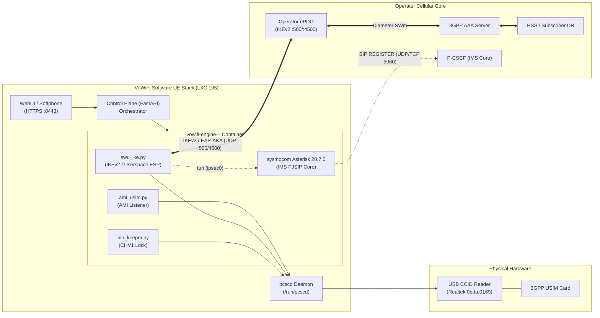

# Technical Architecture

## 1. Overview

The VoWiFi Software User Equipment (UE) architecture provides a bridge between a physical 3GPP USIM card and modern VoIP clients (SIP / WebRTC), implementing the 3GPP **Untrusted Non-3GPP Access** architecture.

---

## 2. Component Layers

### 2.1 Hardware & Physical Layer
* **Smart Card Reader:** Connected via USB to the Proxmox host. Exposed inside LXC 105 as `/dev/bus/usb/001/002`.
* **PC/SC Daemon (`pcscd`):** Handles card power cycles, ATR negotiation, and APDU transactions. Pinned to upstream version `2.3.3` across the host container and engine containers.
* **PIN Keeper (`pin_keeper.py`):** Runs as a background daemon inside the engine container. When a PIN is enabled on the card, it automatically issues the verify command (`00 20 00 01 08 [PIN]`) to keep the card authenticated for both IKEv2 and SIP transactions.

### 2.2 Security & Tunnel Layer (`swu_ike.py`)
* Implements the **3GPP SWu reference point** between the UE and the ePDG.
* **IKEv2 Protocol Engine:**
  * Negotiates cryptographic parameters with the ePDG (`IKE_SA_INIT`).
  * Initiates identity submission (`IKE_AUTH`) presenting the user's Root NAI.
  * Handles EAP-AKA protocol exchanges, passing `RAND` and `AUTN` to the physical card.
  * Derives session keys (`MSK`, `EMSK`, `K_aut`, `K_encr`) using `CryptoMobile`.
* **User-Plane IPsec ESP:**
  * Opens a Linux `tun` device named `ipsec0`.
  * Handles ESP packet encapsulation and decapsulation in user-space, passing decrypted IMS SIP traffic directly to Asterisk.
* **Config Request (CP):**
  * Requests inner IP address assignment (IPv4 or IPv6) and P-CSCF addresses from the ePDG.
  * Writes the discovered P-CSCF address to `/run/vowifi/pcscf`.

### 2.3 IMS & Voice Engine (sysmocom Asterisk)
* **PJSIP IMS Channel Driver:**
  * Configured via dynamically rendered `pjsip.conf` templates (`render.py`).
  * Binds to the `ipsec0` interface and targets the ePDG-assigned P-CSCF.
* **IMS-AKA Authentication Bridge (`ami_usim.py`):**
  * Connects to Asterisk via AMI (Asterisk Manager Interface).
  * Intercepts `Digest-AKAv1-MD5` SIP 401 Unauthorized challenges.
  * Submits the challenge to the physical SIM card via PC/SC and injects the response back into Asterisk to complete registration.
* **SMS-over-IP Engine:**
  * Bridges Asterisk `SIP MESSAGE` to 3GPP RP-DATA/TPDU, allowing browser-based SMS sending and receiving.

### 2.4 Control Plane & User Interface
* **FastAPI Backend:** Provides REST APIs for SIM auto-detection, line provisioning, configuration persistence, and lifecycle control.
* **React WebUI:** Web dashboard with real-time status indicators, WebRTC dialer, and text messaging center.
