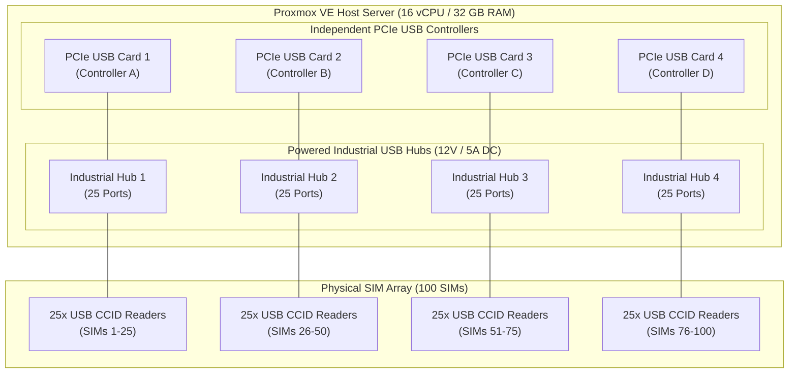
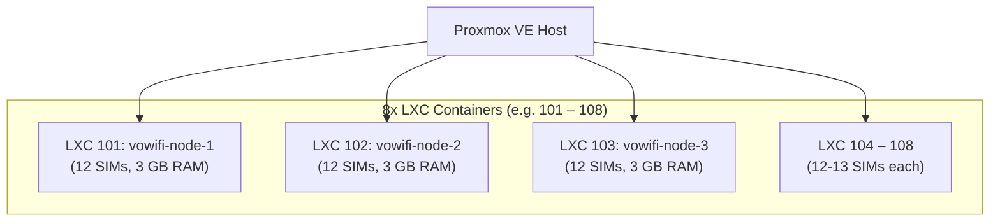

# Capacity Planning & Sizing Guide: 100 Concurrent SIMs

This document details the compute, memory, storage, network, and hardware bus architecture required to scale the VoWiFi Software UE Gateway to **100 concurrent physical SIM cards**.

While the software stack scales horizontally with near-linear efficiency, scaling to 100 SIMs transitions the infrastructure from a single-device setup to a **carrier-grade telecommunications gateway**. The primary engineering challenges reside in **USB controller endpoint limits**, **bus power delivery**, and **smart card daemon context limits**.

---

## 1. Resource Sizing Matrix (Total for 100 SIMs)

| Dimension | Sizing for 100 SIMs | Per-Line & System Breakdown |
| :--- | :--- | :--- |
| **System RAM** | **24 GB – 32 GB** | • **Per-SIM Engine Container:** ~140 MB average (Asterisk: ~60 MB, Python SWu/Crypto: ~50 MB, AMI/PIN guard: ~25 MB).<br>• **100 Engines Total:** ~14 GB.<br>• **Kernel & Network Buffers:** ~4 GB (100 IPsec/XFRM sockets + UDP queues).<br>• **Control Plane, OS & Page Cache:** ~6 GB – 10 GB. |
| **CPU Compute** | **8 to 16 vCPUs**<br>*(x86_64 with **AES-NI**)* | • **Idle State (Keep-alives & DPD):** 100 tunnels sending keep-alives every 20–30s consume ~2–3 cores baseline.<br>• **Active Voice Calls (Transcoding + ESP):** ~0.25 core per active call. At 20–30 concurrent active calls: +5–8 cores.<br>• **Hardware Acceleration:** AES-NI instructions are mandatory to prevent CPU saturation during IPsec ESP encryption/decryption. |
| **Disk Storage** | **60 GB – 100 GB NVMe / SSD** | • **Docker Image:** Shared read-only layer via OverlayFS (~1.2 GB once across all containers).<br>• **Writable Layers & Logs:** Fast NVMe/SSD IOPS are required to handle simultaneous log flushes (`charon.log` and Asterisk call logs) from 100 containers without I/O wait latency. |
| **Network Bandwidth** | **10 Mbps – 20 Mbps** | • **Idle Keep-alives:** ~15 kbps total for 100 tunnels.<br>• **Active Voice (AMR-WB / G.711):** ~80–100 kbps bidirectional per call (audio + RTP + ESP + IP headers).<br>• 20 concurrent calls: ~2 Mbps; 100 concurrent calls: ~10 Mbps. |
| **Port Range** | **6,000 UDP Ports** | • 100 lines × 60 RTP ports = 6,000 ports (e.g., `10000–16000`). Fits comfortably in standard Linux ephemeral port space (`1024–65535`). |

---

## 2. Hardware Architecture & Physical Constraints



### Bottleneck A: USB Host Controller Endpoint Exhaustion
* **The Constraint:** Standard motherboard USB host controllers (xHCI) have a hardware limit of **64 to 96 endpoints**.
* **The Math:** Every USB CCID smart card reader uses **3 to 4 endpoints** (Control, Bulk IN, Bulk OUT, Interrupt IN). 100 readers require **300 to 400 endpoints**.
* **Impact:** Plugging 100 readers into a single onboard USB bus via chained hubs causes the Linux kernel to crash or fail with:
  ```text
  xHCI host controller not responding to stop endpoint command
  cannot allocate new endpoint: out of resources
  ```
* **Solution:** Install **2 to 4 PCIe USB 3.0 expansion cards** equipped with dedicated per-port controller chips (e.g. Renesas uPD720201 or Fresco Logic FL1100EX). Distribute 25–30 readers per controller card.

### Bottleneck B: USB Bus Power Delivery
* 100 USB readers drawing ~100 mA each require **10 Amps at 5V DC (50 Watts)** of continuous power.
* Standard PC ports deliver only 0.5A – 0.9A.
* **Solution:** Use **industrial metal-cased powered USB hubs** equipped with dedicated external 12V/5A power adapters.

### Bottleneck C: Smart Card Daemon Context Limit (`pcsc-lite`)
* In the standard upstream `pcsc-lite` C library, the maximum reader count is hardcoded in `pcsclite.h`:
  ```c
  #define PCSCLITE_MAX_READERS_CONTEXTS 16
  ```
* By default, a single `pcscd` daemon will **ignore any reader past the 16th device**.
* **Workarounds:**
  1. *Option 1:* Recompile `pcsc-lite` with `-DPCSCLITE_MAX_READERS_CONTEXTS=128`.
  2. *Option 2 (Recommended):* Distribute the SIMs across multiple LXC containers.

---

## 3. Recommended Topology: Distributed Multi-LXC Cluster

Instead of running all 100 SIM engines inside a single monolithic container, the recommended deployment pattern is a **Distributed Multi-LXC Cluster**:



### Architectural Comparison

| Criterion | Single Monolithic LXC (100 SIMs in 1 LXC) | Distributed Cluster (8 LXCs × 12–13 SIMs) ⭐ *(Recommended)* |
| :--- | :--- | :--- |
| **`pcsc-lite` Limit** | Requires custom recompile with `MAX_READERS=128`. | **Zero code modifications**; each container stays below the 16-reader limit. |
| **Fault Isolation** | If `pcscd` or Docker stalls, **all 100 SIMs drop**. | If a USB bus hiccups, **only 12 SIMs drop**; the other 88 remain connected. |
| **USB Passthrough** | 100 manual device lines in one container config. | Clean 1-to-1 mapping of 1 physical USB controller/hub per LXC. |
| **Management** | 100 Docker engines in one namespace is unwieldy. | Fast, clean, and easily monitored per node. |
| **Overhead** | Same total CPU / RAM. | Same total CPU / RAM (LXC container virtualization adds zero compute overhead). |

---

## 4. Alternative Industrial Hardware: USB SIM Banks

If you prefer not to manage 100 separate physical USB dongles and cabling, consider **industrial multi-slot USB SIM Arrays / SIM Banks** (e.g., 32-port or 64-port CCID SIM banks):

* **How They Work:** A 1U or 2U rackmount enclosure housing 32 or 64 SIM slots.
* **Controller Interface:** Connects to the host server via a single USB 3.0 or Gigabit Ethernet connection using onboard USB hub controllers and CCID multiplexers.
* **Benefits:** Eliminates cable clutter, provides centralized power distribution, and protects physical SIM cards in a server rack environment.

---

## 5. Host Kernel & OS Tuning for 100 SIMs

To prevent OS-level resource starvation when handling 100 concurrent tunnels and SIP channels, apply the following sysctl parameters on the Proxmox host (`/etc/sysctl.d/99-vowifi-scale.conf`):

```ini
# Increase maximum open file descriptors (Asterisk + Docker sockets)
fs.file-max = 2097152

# Increase network core socket memory buffers
net.core.rmem_max = 16777216
net.core.wmem_max = 16777216
net.core.rmem_default = 1048576
net.core.wmem_default = 1048576

# Increase IPsec and UDP packet queue backlogs
net.core.netdev_max_backlog = 10000

# Increase maximum memory map areas for multi-threaded Asterisk processes
vm.max_map_count = 262144
```

Apply immediately:
```bash
sysctl --system
```
