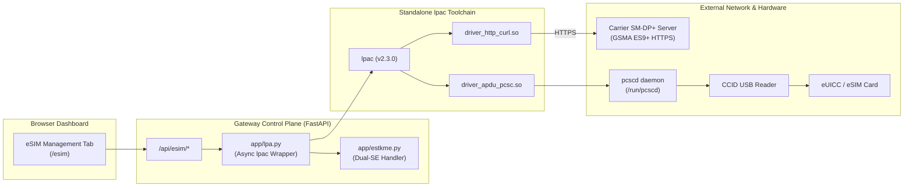

# eSIM / eUICC Profile Management Guide

This document covers hardware requirements, architecture, and operation of the **eSIM / eUICC Local Profile Assistant (LPA)** integrated into the VoWiFi Gateway.

---

## 1. Overview

The VoWiFi Gateway supports physical removable **eUICC (removable eSIM)** cards inserted into standard USB CCID Smart Card Readers. Through the integrated `lpac` C-based LPA and the WebUI dashboard, operators can:

* Query eUICC chip information and **EID** (eUICC Identifier).
* **Download and install eSIM profiles** directly over-the-air from any carrier GSMA SM-DP+ server using an activation code (`LPA:1$smdp.example.com$MATCHING-ID`).
* **Enable / Disable / Delete** installed profiles without physically swapping SIM cards.
* Support dual Security Domains (dual-SE) on advanced cards such as **ESTKme Max** and **ESTKme Plus+**.
* Process and clear GSMA installation notifications.

---

## 2. Supported Hardware

Any CCID-compliant USB smart card reader paired with an eUICC card supporting the GSMA SGP.22 standard:

* **Removable eUICC Cards:**
  * **ESTKme** (ESTKme Max, ESTKme Plus+, ESTKme Slim)
  * **9eSIM** / **eSIM.me** cards
  * **Sysmocom** sysmoEUICC cards
* **USB CCID Readers:**
  * Realtek (e.g. 0bda:0169)
  * Omnikey / Identiv / ACS CCID readers

---

## 3. Architecture & Requirements



### Required Dependencies
* **PC/SC Smart Card Driver:** `libpcsclite` (pinned across host and containers) for APDU communication.
* **HTTP/TLS Engine:** `libcurl4-openssl-dev` for HTTPS sessions with carrier SM-DP+ servers.
* **CMake 3.31+:** Used for building the relocatable standalone toolchain with CMP0177 policy.
* **Executable Location:** `/root/vowifi_gateway/data/lpac/lpac`

---

## 4. Installation

Run the turnkey installation script inside your LXC container:
```bash
/root/vowifi/scripts/install_esim_lpac.sh
```

The script performs the following automatically:
1. Installs build tools (`build-essential`, `pkg-config`, `libcurl4-openssl-dev`).
2. Ensures CMake $\ge$ 3.31.
3. Clones and compiles `lpac` with PC/SC APDU and cURL HTTP drivers enabled (`STANDALONE_MODE=ON`, `BUILD_TESTING=OFF`).
4. Installs the standalone executable into `/root/vowifi_gateway/data/lpac/`.
5. Restarts `vowifi-control.service` to immediately activate the eSIM management UI.

---

## 5. Verification

### 1. Verify Status via Web API
```bash
curl -sk https://127.0.0.1:8443/api/esim/status | jq .
```
Expected output:
```json
{
  "available": true,
  "lpac_bin": "/root/vowifi_gateway/data/lpac/lpac",
  "download_timeout": 300,
  "auto_process_notifications": true,
  "busy_readers": []
}
```

### 2. Verify Hardware Reader Detection via CLI
```bash
/root/vowifi_gateway/data/lpac/lpac driver apdu list
```
Expected output:
```json
{"type":"driver","payload":{"env":"LPAC_APDU_PCSC_DRV_IFID","data":[{"env":"0","name":"Generic USB2.0-CRW [Smart Card Reader Interface] (20070818000000000) 00 00"}]}}
```

---

## 6. How to Use

### Downloading an eSIM Profile
1. Log in to the WebUI dashboard at `https://<LXC_IP>:8443`.
2. Navigate to the **eSIM** tab.
3. Select your reader from the dropdown. The card's **EID** will be displayed.
4. Click **Download Profile**:
   * Enter the **Activation Code** (e.g. `LPA:1$smdp.carrier.com$ABCD-1234-EFGH`).
   * (Optional) Enter the Confirmation Code if required by the carrier.
5. Click **Start Download**. The real-time progress of mutual authentication (ES9+), profile download, and installation will be displayed.

### Activating a Profile
1. In the profiles table, click **Enable** next to the desired carrier profile.
2. The eUICC will make that profile active.
3. The gateway will recognize the active IMSI and authenticate with the carrier's ePDG and VoWiFi IMS core automatically.
