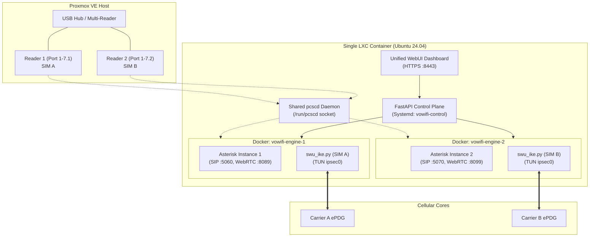

# Multi-SIM & Multi-Line Deployment Guide

Yes, a single LXC container can host and run **multiple concurrent VoWiFi lines with multiple physical SIM cards**.

The system was architected from the ground up as a multi-tenant cellular gateway. A single control plane and WebUI dashboard can orchestrate dozens of concurrent SIM connections, each isolated inside its own containerized engine.

---

## 1. How Multi-SIM Works Internally



### Architectural Highlights

1. **Network Namespace Isolation:**
   * Each SIM line runs in its own dedicated Docker engine container (`vowifi-engine-<id>`).
   * Each container has an isolated network namespace and its own virtual `ipsec0` TUN interface.
   * **No Routing Conflicts:** Even if two SIM cards connect to the same carrier and receive identical private cellular IP ranges (e.g., `10.x.x.x`), the routing tables never collide because they reside in separate network namespaces.

2. **Automatic Port Allocation:**
   * The control plane automatically assigns non-overlapping port blocks for each line:
     * **Line 1:** SIP UDP `5060`, SIP TLS `5061`, WebRTC `8089`, AMI `5038`, RTP `10000–10059`
     * **Line 2:** SIP UDP `5070`, SIP TLS `5071`, WebRTC `8099`, AMI `5048`, RTP `10060–10119`
     * **Line 3:** SIP UDP `5080`, SIP TLS `5081`, WebRTC `8109`, AMI `5058`, RTP `10120–10179`

3. **Physical USB Port Pinning (`reader_port`):**
   * Linux USB enumeration can reorder device indices (`Reader 0`, `Reader 1`) across reboots.
   * The gateway resolves this by binding each line to its **physical USB hub topology** (e.g., `1-7.1`, `1-7.2`) or **ICCID**, ensuring each cellular line stays permanently mapped to the correct SIM.

4. **Resource Sizing:**
   * Asterisk + Python SWu consumes only **~100–150 MB RAM** per active line.
   * A 4 GB RAM LXC container can comfortably run **10–15 concurrent active SIM lines**.

---

## 2. Step-by-Step Configuration for Multiple Readers

### Step 1: Connect Readers to the Host
Plug multiple USB card readers into the Proxmox host (or into a powered USB hub connected to the host).

Run `lsusb` on the Proxmox host to verify device nodes:
```bash
lsusb
```
Example output:
```text
Bus 001 Device 002: ID 0bda:0169 Realtek Semiconductor Corp. (Reader 1)
Bus 001 Device 003: ID 0bda:0169 Realtek Semiconductor Corp. (Reader 2)
```

### Step 2: Ensure Host Udev Permissions
The host udev rule matches any reader with that Vendor/Product ID:
```udev
SUBSYSTEM=="usb", ATTR{idVendor}=="0bda", ATTR{idProduct}=="0169", MODE="0666"
```
If you use readers from different manufacturers (e.g., Omnikey, ACS), add an additional rule for their VID/PID or match the USB class (`bInterfaceClass=="0b"` for CCID).

### Step 3: Pass Devices to Container (`/etc/pve/lxc/<VMID>.conf`)
On the Proxmox host, add a `devX` entry for each reader node:

```ini
features: nesting=1,keyctl=1
dev0: /dev/bus/usb/001/002,mode=0666    # USB Reader 1
dev1: /dev/net/tun,mode=0666             # Shared TUN device
dev2: /dev/bus/usb/001/003,mode=0666    # USB Reader 2
dev3: /dev/bus/usb/001/004,mode=0666    # USB Reader 3 (if applicable)
```

Apply changes by rebooting the container (`pct reboot <VMID>`).

### Step 4: Verify Inside the Container
Run inside the LXC container:
```bash
opensc-tool -l
```
You should see all connected readers listed:
```text
#0  Generic USB2.0-CRW [Smart Card Reader Interface] 00 00
#1  Generic USB2.0-CRW [Smart Card Reader Interface] 01 00
```

---

## 3. Provisioning Multiple Lines in WebUI

1. Open your browser at `https://<LXC_IP>:8443`.
2. The dashboard's background card monitor detects all inserted cards automatically.
3. Click **"Add Line"**:
   * Select the detected SIM / Reader slot.
   * Enter the carrier APN (`ims`) and settings (`idr_mode: apn`).
   * Port allocation defaults to **Automatic** (allocates the next available port block).
4. Click **"Save & Start"**:
   * The control plane spins up `vowifi-engine-2`.
   * The new engine mounts `/run/pcscd` and connects to its assigned reader.
   * Both Line 1 and Line 2 will display active registration statuses on the dashboard simultaneously.

---

## 4. Using the Softphone and SMS with Multiple Lines

* **WebRTC Softphone:** The WebUI provides a line selector to switch between active SIM lines for inbound and outbound calls.
* **SMS Messages:** Each line maintains independent SMS threads and outbox delivery channels mapped to its respective carrier IMS core.
* **External PBX / SIP Trunking:** You can point an external PBX (FreePBX, Kamailio, Asterisk) to each line's unique SIP UDP port (e.g. `192.168.1.105:5060` for Line 1, `192.168.1.105:5070` for Line 2) to treat each SIM as an independent cellular trunk.
