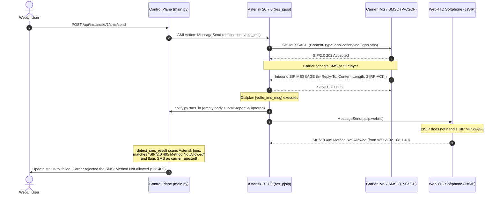

# SMS Delivery Resolution & SIP 405 False Positive Diagnosis

## Symptom

When sending an outbound SMS (Mobile-Originated / MO SMS) via the VoWiFi Gateway WebUI:
* The SMS was physically delivered to the recipient's handset.
* However, the WebUI message status transitioned to `failed`:
  ```text
  Failed to deliver
  Carrier rejected the SMS: Method Not Allowed (SIP 405)
  ```

---

## Root Cause Analysis

Investigation of the Asterisk SIP debug trace and the control plane logs revealed that the carrier **never rejected the SMS**. Instead, the failure was triggered by a loopback SIP 405 response from the local browser softphone.

### Detailed Event Sequence



### Key Technical Findings

1. **Carrier Layer Acceptance:**
   * The carrier's P-CSCF responded to our outbound MESSAGE with `SIP/2.0 202 Accepted` (`Variable: MESSAGE_SEND_STATUS Value: SUCCESS`).
   * Shortly after, the carrier SMS router (`cmsss01.ims.mnc003.mcc470.3gppnetwork.org`) transmitted an incoming SIP `MESSAGE` containing a 2-byte 3GPP RP-ACK submit report (`02 00`).
   * Asterisk answered the carrier with `SIP/2.0 200 OK`.

2. **Unwanted Dialplan Relay to WebRTC:**
   * Asterisk's dialplan template (`[volte_ims_msg]`) contained:
     ```jinja2
     
     same => n,MessageSend(pjsip:{{ t }},${MESSAGE(from)},sip:{{ t }})
     
     ```
   * Because `webrtc_enable` was true, `msg_targets` included `webrtc`.
   * Asterisk attempted to relay the incoming submit-report MESSAGE to the browser softphone (`JsSIP` over WebSocket `WSS:192.168.1.40:50364`).
   * Since JsSIP in the browser softphone is configured purely for audio WebRTC calls, it responded with `SIP/2.0 405 Method Not Allowed`.

3. **Flawed Response Matching in Control Plane:**
   * `detect_sms_result(iid, since)` parsed Asterisk logs matching `Received SIP response`.
   * It did not check the source transport of the response (e.g. `TCP:[2401:...` vs `WSS:192.168...`).
   * When it saw the browser's `SIP/2.0 405 Method Not Allowed` with `CSeq: ... MESSAGE`, it misidentified it as a rejection from the mobile operator's core network.

4. **3GPP TS 24.011 Submit Report PDU Length Check:**
   * The sysmocom Asterisk fork's `res_pjsip_messaging.c:parse_rpdata` contained an over-strict length check:
     ```c
     if (len < 3) {
         ast_log(LOG_DEBUG, "MESSAGE RP-DATA is too short or error: %d.\n", len);
         return;
     }
     ```
   * In 3GPP TS 24.011 Table 7.3, an RP-ACK without optional user data is exactly 2 octets (RP-MTI + RP-MR).
   * Because `len == 2`, Asterisk skipped logging `SMS RP-DATA '0200'`, preventing the control plane from reading the positive verdict before falling back to SIP responses.
   * Furthermore, `_decode_rp_report` checked `mti == 3` (MS-to-Network RP-ACK) rather than `mti == 2` (Network-to-MS RP-ACK).

---

## Applied Solutions

### 1. Dialplan Template (`extensions.conf.j2`)
Removed `webrtc_user` from `msg_targets`:
* The browser WebUI handles SMS via standard HTTP endpoints (`/api/instances/{id}/messages`) and WebSocket notifications emitted by `notify.py sms_in`.
* Disabling `MessageSend(pjsip:webrtc)` eliminates unnecessary SIP traffic over WebSocket and prevents JsSIP 405 responses.

### 2. Control Plane Log Detection (`control/app/main.py`)
* **Transport Filtering:** In `detect_sms_result`, any SIP response originating from `WSS:` or addressed to `webrtc` is explicitly ignored.
* **Status Code Qualification:** Only SIP status codes `>= 400` received from the carrier transport indicate IMS rejection.
* **3GPP TS 24.011 Compliance:** `_RP_ACK_MTIS` was expanded to `{2, 3}` (2 = Network-to-MS, 3 = MS-to-Network) and `_RP_ERROR_MTIS` to `{4, 5}`.
* **Fallback Detection:** Added detection for 2-byte submit reports logged by Asterisk as `MESSAGE RP-DATA is too short or error: 2.` or `RP-ACK submit report received`.

### 3. Asterisk `res_pjsip_messaging.c` Patch
Lowered the minimum length check from `len < 3` to `len < 2` and updated the switch to handle both Network-to-MS and MS-to-Network RP-ACK / RP-ERROR MTIs (`0x00`, `0x01`, `0x02`, `0x03`, `0x04`, `0x05`).
