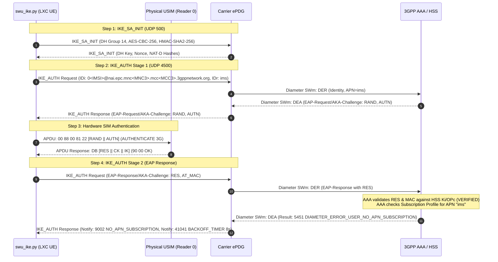

# 3GPP VoWiFi Registration Trace & Cryptographic Analysis

This document provides a detailed, packet-by-packet trace of the IKEv2 / EAP-AKA authentication and PDN connection handshake between the software UE and a cellular operator's ePDG.

---

## 1. Sequence Diagram



---

## 2. Packet Analysis & Log Trace

### Step 1: `IKE_SA_INIT` Exchange
The client begins Phase 1 negotiation over UDP port 500:

```text
STATE 1:
sending IKE_SA_INIT
NAT SOURCE [hash]
NAT DESTINATION [hash]

received IKE_SA_INIT
[swu_ike] received Notify: NAT_DETECTION_SOURCE_IP (16388, STATUS)
[swu_ike] received Notify: NAT_DETECTION_DESTINATION_IP (16389, STATUS)
[swu_ike] received Notify: IKEV2_FRAGMENTATION_SUPPORTED (16430, STATUS)
```

* **Diffie-Hellman Key Exchange:** Group 14 (2048-bit MODP)
* **Encryption Algorithm:** `AES-CBC-256`
* **Integrity Algorithm:** `HMAC-SHA2-256-128`
* **Derived Secrets:** Key material (`SKEYSEED`, `SK_EI`, `SK_ER`, `SK_AI`, `SK_AR`) derived according to RFC 7296.

---

### Step 2: `IKE_AUTH (1)` — Identity Submission
The client switches to UDP port 4500 (NAT-Traversal) and sends its encrypted identity:

```text
STATE 2:
sending IKE_AUTH (1)
IDi (Root NAI): 0<IMSI>@nai.epc.mnc<MNC3>.mcc<MCC3>.3gppnetwork.org
IDr (Target APN): ims
```

* **Root NAI Structure (3GPP TS 23.003):**
  * `0`: EAP-AKA identity prefix.
  * `<IMSI>`: 15-digit subscriber IMSI.
  * `nai.epc.mnc<MNC3>.mcc<MCC3>.3gppnetwork.org`: Standard 3GPP EPC realm.

The operator ePDG validates the identity with the 3GPP AAA server and responds with an **EAP-Request/AKA-Challenge**:

```text
received IKE_AUTH (1)
EAP-Type: EAP-AKA (23) Subtype: AKA-Challenge (1)
Payload: [RAND, AUTN, MAC]
```

---

### Step 3: Hardware SIM Authentication
The software client passes the challenge directly to the physical SIM card using the standard ISO 7816 `AUTHENTICATE` command:

```text
Sending APDU: 00 88 00 81 22 10 [RAND] 10 [AUTN]
```

The SIM's internal cryptographic coprocessor executes the **Milenage** algorithm using its burned-in secret key (`Ki`) and operator code (`OPc`). The card validates that the network is authentic (`AUTN` validation) and returns:

```text
APDU Status: 90 00 (Success)
Data: [RES || CK || IK]
```

Using `CryptoMobile`, `swu_ike.py` derives the master session keys:
* `MSK` (Master Session Key)
* `EMSK` (Extended Master Session Key)
* `K_aut` (Authentication Key)
* `K_encr` (Encryption Key)

---

### Step 4: `IKE_AUTH (2)` — EAP-AKA Response & Network Decision
The UE replies with the computed `RES` and `AT_MAC`:

```text
STATE 3:
sending IKE_SA_AUTH (2)
Payload: EAP-Response/AKA-Challenge
AT_RES: [Computed RES]
AT_MAC: [HMAC over K_aut]
```

The operator AAA server verifies `RES` against the HSS. **Authentication is successfully verified.**  
If the subscriber account does not have VoWiFi / VoLTE provisioned in their subscription profile, the HSS reports:

```text
[swu_ike] received ERROR Notify during IKE_AUTH: NO_APN_SUBSCRIPTION (9002)
Diameter Mapping: DIAMETER_ERROR_USER_NO_APN_SUBSCRIPTION (Code 5451)
[swu_ike] received Notify: BACKOFF_TIMER (41041, STATUS)
```

---

## 3. Conclusion

The end-to-end cryptographic and signaling pipeline functions as expected:
1. Physical USB CCID communication with the USIM card operates correctly.
2. The operator ePDG is reached and accepts IKEv2 negotiations.
3. Cryptographic mutual authentication (EAP-AKA) between the SIM and the core network completes successfully.
4. Any `NO_APN_SUBSCRIPTION` response indicates that the subscriber profile must have VoWiFi/IMS provisioned on the carrier side.
