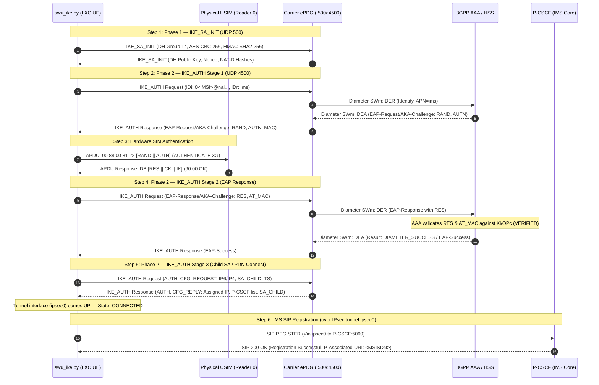

# 3GPP VoWiFi Registration Trace & Cryptographic Analysis

This document provides a detailed, packet-by-packet trace of the IKEv2 / EAP-AKA authentication, IPsec tunnel establishment, and IMS SIP registration between the software UE and the mobile operator core network.

---

## 1. Sequence Diagram: Full End-to-End Registration



---

## 2. Packet Analysis & Log Trace

### Step 1: `IKE_SA_INIT` Exchange
The client initiates Phase 1 security association over UDP port 500:

```text
STATE 1:
sending IKE_SA_INIT
NAT SOURCE [hash]
NAT DESTINATION [hash]

received IKE_SA_INIT
[swu_ike] received Notify: NAT_DETECTION_SOURCE_IP (16388, STATUS)
[swu_ike] received Notify: NAT_DETECTION_DESTINATION_IP (16389, STATUS)
[swu_ike] received Notify: IKEV2_FRAGMENTATION_SUPPORTED (16430, STATUS)
```

* **Diffie-Hellman Key Exchange:** Group 14 (2048-bit MODP).
* **Encryption Algorithm:** `AES-CBC-256`.
* **Integrity Algorithm:** `HMAC-SHA2-256-128`.
* **Derived Secrets:** Key material (`SKEYSEED`, `SK_EI`, `SK_ER`, `SK_AI`, `SK_AR`) derived according to RFC 7296.

---

### Step 2: `IKE_AUTH (1)` — Identity Submission
The client transitions to UDP port 4500 (NAT-Traversal) and sends its encrypted identity:

```text
STATE 2:
sending IKE_AUTH (1)
IDi (Root NAI): 0<IMSI>@nai.epc.mnc<MNC3>.mcc<MCC3>.3gppnetwork.org
IDr (Target APN): ims
```

* **Root NAI Structure (3GPP TS 23.003):**
  * `0`: EAP-AKA identity prefix.
  * `<IMSI>`: 15-digit subscriber IMSI.
  * `nai.epc.mnc<MNC3>.mcc<MCC3>.3gppnetwork.org`: Standard 3GPP EPC realm.

The operator ePDG validates the identity with the 3GPP AAA server and returns an **EAP-Request/AKA-Challenge**:

```text
received IKE_AUTH (1)
EAP-Type: EAP-AKA (23) Subtype: AKA-Challenge (1)
Payload: [RAND, AUTN, MAC]
```

---

### Step 3: Hardware SIM Authentication
The software client passes the challenge vectors directly to the physical SIM card using standard ISO 7816 `AUTHENTICATE`:

```text
Sending APDU: 00 88 00 81 22 10 [RAND] 10 [AUTN]
```

The SIM's internal cryptographic coprocessor executes the **Milenage** algorithm with its secret key (`Ki`) and operator code (`OPc`). The card confirms network authenticity (`AUTN`) and returns:

```text
APDU Status: 90 00 (Success)
Data: [RES || CK || IK]
```

Using `CryptoMobile`, `swu_ike.py` calculates the master session keys:
* `MSK` (Master Session Key)
* `EMSK` (Extended Master Session Key)
* `K_aut` (Authentication Key)
* `K_encr` (Encryption Key)

---

### Step 4: `IKE_AUTH (2)` — EAP-AKA Response & Authentication Success
The UE replies with the calculated `RES` and `AT_MAC`:

```text
STATE 3:
sending IKE_SA_AUTH (2)
Payload: EAP-Response/AKA-Challenge
AT_RES: [Computed RES]
AT_MAC: [HMAC over K_aut]

received decoded message:
[[46, [[48, [3, ...]]]]]   # EAP-SUCCESS (Code 3)
received IKE_AUTH (2)
```

The 3GPP AAA server confirms the credentials match the HSS database and issues **EAP-SUCCESS**. Mutual authentication is complete.

---

### Step 5: `IKE_AUTH (3)` — Child SA & PDN Connectivity (IPsec Tunnel UP)
The UE requests Packet Data Network (PDN) IP allocation and P-CSCF server addresses:

```text
STATE 4:
sending IKE_AUTH (3)
Payloads: AUTH, CFG_REQUEST (INTERNAL_IP6_ADDRESS, P_CSCF_IP6_ADDRESS), SA_CHILD, TS

received IKE_AUTH (3)
IPSEC RESP SPI: [Responder SPI]
IPSEC INIT SPI: [Initiator SPI]
IPV6 ADDRESS:   ['2401:...::1']
P-CSCF IPV6:    ['2401:...:82', '2401:...:182']

STATE CONNECTED.

cmd: ip -6 addr add fe80::1/64 dev ipsec0
cmd: ip -6 addr add 2401:...::1/64 dev ipsec0
cmd: route -A inet6 add ::/1 dev ipsec0
cmd: route -A inet6 add 8000::/1 dev ipsec0
cmd: ip link set dev ipsec0 mtu 1400
[swu_ike] tunnel CONNECTED inner=2401:...::1 pcscf=2401:...:82 iface=ipsec0
```

---

### Step 6: IMS SIP Registration over Tunnel
With the IPsec tunnel established (`ipsec0`), Asterisk generates `pjsip.conf` dynamically and initiates SIP registration with the carrier P-CSCF:

```text
Asterisk CLI: pjsip show registrations

 <Registration/ServerURI..............................>  <Auth....................>  <Status.......>
==========================================================================================
 volte_ims/sip:ims.mnc<MNC3>.mcc<MCC3>.3gppnetwork.org   volte_ims                   Registered (exp. 2946s)

Objects found: 1
```

* **Status:** `Registered`.
* **MSISDN Discovery:** The carrier returns `SIP/2.0 200 OK` with header `P-Associated-URI: <tel:+...>`, auto-populating the subscriber phone number in the WebUI.
* **Control Plane State:** `Working (OK)` — ready to place/receive calls via WebRTC softphone and send/receive carrier SMS.

---

## 3. Troubleshooting & Common Reject Codes

If the carrier rejects registration during Step 4, inspect `/run/vowifi/charon.log`:

| Notify Code | Reject Name | Root Cause & Resolution |
| :--- | :--- | :--- |
| **`9002`** | `NO_APN_SUBSCRIPTION` | The SIM credentials authenticated, but the subscriber profile does not have VoWiFi / `ims` APN enabled on the carrier's HSS. Contact customer care or dial the carrier activation USSD to enable Wi-Fi Calling. |
| **`24`** | `AUTHENTICATION_FAILED` | Carrier ePDG rejected identity format before querying card. Set `idr_mode: apn` (bare string `"ims"`) instead of full FQDN. |
| **`9000`** | `NON_3GPP_ACCESS_TO_EPC_NOT_ALLOWED` | Subscription bars Untrusted Non-3GPP / Wi-Fi access. Carrier provision required. |
